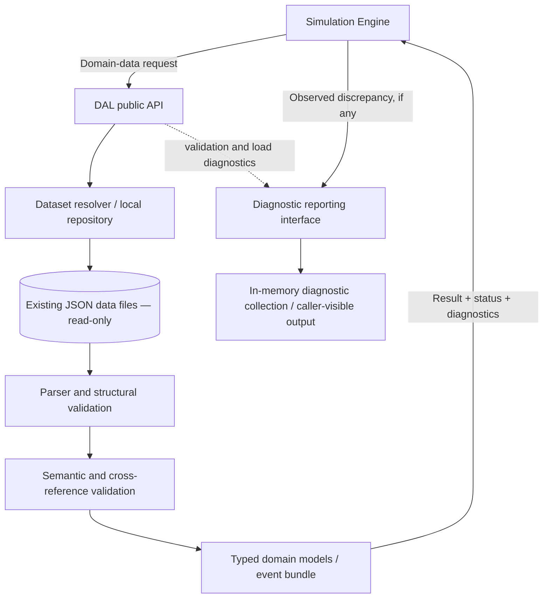

# F1 Simulator — Data Access Layer (DAL)

**Document type:** Architecture and implementation specification  
**Status:** Authoritative requirements for the first DAL implementation  
**Scope:** Local, read-only access to the simulator's repository data  
**Primary language:** C++ (use the repository's established standard and build conventions)

## 1. Purpose

Build a well-defined boundary between the F1 simulation engine and the simulator's local data files. The Simulation Engine must request domain data from the Data Access Layer (DAL); it must not independently open, parse, or navigate the repository's JSON files. The DAL locates those files, reads them, parses and validates them, converts them into typed C++ domain objects, checks relationships between related datasets, and returns either a usable result or structured diagnostics.

The DAL is an **internal-file access layer**, not an internet agent, scraper, database server, model, or simulation engine. It reads existing local repository files only. It does not download, repair, infer, calibrate, generate, overwrite, rename, or delete source data.

This document specifies expected behavior and architectural boundaries. The implementer must inspect the current repository and actual JSON schemas before choosing exact field names, identifiers, class members, and file paths. Do not assume that an example in this document supersedes the real repository.

## 2. Non-negotiable requirements

1. **Data files are read-only.** Existing files under `data/` must not be modified, regenerated, reformatted, renamed, moved, deleted, or overwritten. Tests must never use those files as writable fixtures. Any inconsistency is a finding to report, not permission to repair the data.
2. **No runtime internet access.** No HTTP calls, web scraping, cloud APIs, agent calls, Gemini API key, database service, or network fallback. Runtime data comes from the configured local repository data directory only.
3. **No silent substitutions.** Missing, `null`, malformed, unavailable, assumed, or uncalibrated values must not silently become `0`, an empty string, a default compound, or another plausible value. A verified physical zero remains valid when the data schema and provenance support it.
4. **Unknown is not corrupt.** A valid record can contain a legitimately unknown or uncalibrated parameter. Preserve that state explicitly. Do not reject an otherwise readable circuit/event bundle solely because a parameter needed only by a particular simulation calculation is unknown.
5. **Typed public interface.** The Simulation Engine should consume typed C++ objects and structured result/status types, not perform its own JSON navigation. JSON parser types should remain an implementation detail of the DAL wherever practical.
6. **Two-way diagnostics, not autonomous repair.** The Engine receives structured results and can report a discrepancy it notices. The DAL may return or collect diagnostic information, but no feedback path may silently rewrite data, recalibrate values, invent replacements, or retry indefinitely.
7. **Do not hard-code one race weekend into the design.** Silverstone and the 2026 British Grand Prix are the initial data currently known to exist, not special cases in core logic. Use dataset identifiers, relationships, and repository conventions discovered by inspection.
8. **Respect the repository.** Inspect current files and uncommitted changes before making edits. Do not discard or overwrite unrelated work. Do not commit or push unless separately asked.
9. **Honest validation.** Never claim a file was inspected, compiled, or tested unless that actually occurred. Clearly identify environmental blockers and unverified items.

## 3. Architectural overview



The diagram is conceptual. The implementation may split the resolver, parser, validators, repositories, and public facade into different classes or modules, provided the responsibilities and behavior remain clear and testable.

### 3.1 Responsibilities

**Simulation Engine**
- Requests a complete event bundle during simulation setup and can request individual datasets when needed.
- Uses the returned typed objects for race/tyre/vehicle calculations.
- Decides whether the data available is sufficient for a particular simulation capability or calculation.
- Reports runtime observations or contradictions through the diagnostic interface when useful.
- Does not read JSON files or reconstruct repository paths itself.

**Data Access Layer**
- Accepts a configured local data root.
- Resolves supported dataset identifiers to files beneath that root.
- Reads files without writing to them.
- Parses JSON, validates supported schema versions, maps fields to typed objects, and checks cross-file relationships.
- Represents unknown values and provenance faithfully.
- Returns structured success/failure results, warnings, and errors.
- Can expose a simple diagnostic reporting/collection interface for observations reported by the Engine.

**Local data files**
- Remain the authoritative source for stored data.
- Are never repaired or normalized by the DAL on disk.
- Are not confused with research notes, reports, manifests, source-register Markdown, test fixtures, or build artifacts.

**Research/documentation files**
- `docs/f1_simulator_mathematical_framework.md` defines the model's intended domain boundaries and should be read by the implementer.
- Files under `research/` are research/provenance artifacts, not ordinary runtime datasets. Do not make runtime simulation depend on them unless repository inspection proves a specific documented runtime requirement.

## 4. Repository inspection comes first

Before implementing, inspect the live repository and verify its current state. At the last user-provided `git ls-files` listing, the tracked set included the following, but the implementer must re-check it rather than assume it is still current:

```text
data/compounds/2026_pirelli_slick_catalogue_v1.json
data/events/2026_british_gp_config.json
data/events/2026_british_gp_role_mapping.json
data/tracks/silverstone_gp_layout_v2011.json
data/tracks/silverstone_gp_surface_v2019.json
docs/f1_simulator_mathematical_framework.md
research/manifests/2026_silverstone_v1.json
research/reports/2026_silverstone_research_and_validation_report.md
research/sources/sources.md
src/main.cpp
```

The last listing showed `src/main.cpp` as empty. Do not assume it is still empty. Inspect it and all relevant build files before deciding how to integrate the DAL.

Inspect the actual contents and structure of each runtime JSON file. Confirm its root object, IDs, version fields, nullable fields, units, provenance metadata, and inter-file references. Do not invent field names or infer undocumented semantics from filenames alone.

A previously observed possible issue needs verification: the Silverstone batch manifest appeared to refer to `data/sources.md` and `data/reports/2026_silverstone_research_and_validation_report.md`, while the listed files were under `research/sources/` and `research/reports/`. If this inconsistency still exists, record it in the final findings. Do not fix the manifest or move files as part of DAL work.

## 5. Runtime data scope and supported concepts

The first implementation must support the current real datasets found in the repository, including the following concepts where present in the inspected schemas:

- **Track layout/geometry:** physical layout identity and version, length, corner/sector metadata, and other layout fields actually stored.
- **Track surface profile:** surface dataset identity/version and stored surface characteristics, keeping this separate from the circuit layout.
- **Event configuration:** season/event identity, round, dates/format, lap count, pit-lane/operating rules, and other stored event-specific configuration.
- **Event tyre-role mapping:** mapping between event-specific labels such as Hard/Medium/Soft and the physical compound identifiers used for that event.
- **Physical compound catalogue:** C1–C5 identities and other stored physical/specification fields, along with nullable calibration fields, provenance, confidence, and missing-data policy.

The current files are likely arranged under `data/tracks/`, `data/events/`, and `data/compounds/`. Verify the present directory layout. The DAL must not require or parse unrelated `research/`, `docs/`, `.git/`, build, or temporary-test directories as runtime data.

Design the code so that later datasets (for example vehicle specifications, calibrated model parameters, and scenario configurations) can be added without redesigning the entire DAL. However, **do not invent schemas or fabricate implementations for datasets that do not yet exist**. Implement and test the data types and queries supported by actual repository files; document extension points for future types.

## 6. API behavior

### 6.1 Main entry point: load a complete event bundle

Provide a primary API conceptually equivalent to:

```cpp
DataAccessLayer dal(configured_data_root);
Result<EventBundle> result = dal.loadEventBundle(event_id);
```

This example describes behavior, not a mandatory exact signature. Match the project's C++ standard and coding style.

The event bundle should combine the event configuration, event tyre-role mapping, related track layout, related surface profile, and applicable physical compound catalogue, based on the actual identifiers and relationships in the JSON files. Do not assume the exact relationship mechanism before inspecting the files.

- A bundle succeeds when all structurally required bundle components are found and their required relationships are valid.
- A nullable/unknown calibration value does not, by itself, make the bundle structurally invalid.
- Structural errors, missing required files, unsupported schema versions, or broken required cross-references must be returned as failures with actionable diagnostics.
- Warnings may accompany a successful bundle when fields are legitimately unknown or contain lower-confidence/assumed values.
- Return an immutable or effectively read-only bundle to callers where practical.

The Engine should normally load a bundle during simulation setup and reuse that snapshot across many strategy evaluations. Do not repeatedly reopen and parse the same files for every lap/tyre calculation. A sophisticated cache, filesystem watcher, background refresh thread, or hot-reload mechanism is not required in the first implementation. If any caching is added, document its lifetime and explicit reload behavior, and ensure it cannot conceal errors or unexpectedly stale data.

### 6.2 Individual dataset queries

Also support a small set of typed individual requests, appropriate to the current data, such as:

- load a track layout by stable track/layout identifier;
- load a surface profile by stable track/surface identifier;
- load an event configuration by event identifier;
- load an event tyre-role mapping by event identifier;
- load a physical compound catalogue or compound record by its supported identifier/version.

The exact signatures and granularity should be chosen after schema inspection. Avoid a sprawling generic query language. These requests are useful when a caller genuinely needs one dataset without constructing a full bundle.

Do not require the caller to pass arbitrary filesystem paths for ordinary domain requests. Resolve domain identifiers through a controlled resolver. If the design needs an explicit path-based low-level method internally, keep it private or narrowly scoped and enforce root confinement.

### 6.3 Typed data objects

Create domain objects that represent the current JSON records. Model all currently relevant fields that the simulator can reasonably consume, including identity/version and provenance or data-quality fields where present. Avoid exposing the JSON library's raw value object as the normal public data model.

The exact members must follow the real JSON schemas. At minimum, distinguish:

- required structural identity fields;
- optional or legitimately unknown numeric values;
- arrays/collections whose absence has defined meaning;
- explicit source/provenance metadata;
- observed/published, derived, estimated, calibrated, and assumed values when the source represents that distinction;
- measurement units and validity/version information where present.

Use `std::optional<T>` or an equivalent explicit value-state representation for nullable/unknown data. If the schema distinguishes a missing key from an explicit `null`, preserve that difference in validation/diagnostics when meaningful. Do not reduce an unknown value to zero. Do not apply conversions, recalculate values, or change semantic meanings while loading. Any computed/derived values belong in an explicitly documented later/model layer, not in the file loader.

### 6.4 Result and diagnostic contract

Every public request must return a clear result with either a usable typed value or a structured failure, plus zero or more diagnostics. A custom `Result<T>` is acceptable; use an established result type only if the repository already has one and it fits the project's language standard.

Conceptually:

```cpp
struct Diagnostic {
    Severity severity;
    DiagnosticCode code;       // Stable machine-readable category
    std::string message;       // Human-readable explanation
    std::string dataset_id;    // When known
    std::string relative_path; // Path relative to configured data root, when known
    std::string field_path;    // JSON Pointer or equivalent, when known
    std::string expected;      // Optional context
    std::string actual;        // Optional context
};

// Result<T> should carry a status, optional value, and diagnostics.
```

Use a controlled status/code set that distinguishes, as applicable:

- success;
- invalid request/identifier;
- dataset/file not found;
- file read/permission error;
- malformed JSON;
- unsupported schema version;
- structural/schema validation failure;
- invalid range/type/enum;
- cross-reference or referential-integrity failure;
- legitimate unknown/unavailable value;
- incompatible or insufficient data for a requested capability;
- path outside the configured data root;
- unexpected internal failure.

Do not force every warning to be a failure. The result should let callers distinguish a successfully loaded record with unknown fields from a record that cannot safely be loaded. Do not leak absolute machine-specific paths unnecessarily; repository-relative paths are preferred in diagnostics.

Avoid using exceptions as ordinary control flow. Catch parsing and filesystem exceptions at the DAL boundary and translate them into diagnostics. Do not swallow errors or return an empty/default object after a failure. Internal programmer errors may be handled separately according to project conventions.

## 7. Validation rules

Apply validation in clear stages so tests can identify the source of a problem:

1. **Request validation:** requested identifier is non-empty and valid for the API.
2. **Path resolution and I/O:** target resolves under the configured root, exists, is a regular file, and can be read.
3. **JSON parsing:** content is syntactically valid JSON.
4. **Schema/version validation:** root type, required structural keys, field types, supported schema version, enum values, and structural shapes are valid.
5. **Semantic validation:** valid ranges and internal invariants according to the source schema/framework; do not invent new physical assumptions.
6. **Cross-dataset validation:** IDs and references between an event, track layout, surface profile, role mapping, and compound catalogue resolve correctly where required.
7. **Simulation sufficiency:** report the values that are unknown or unsupported, but leave the decision about whether a particular simulation can run to the Engine's requested capability/calculation.

Use documented ranges and rules where the JSON schema or mathematical framework defines them. Do not create unsupported rejection rules based on guesses. When a required rule cannot be established from the repository, report the uncertainty and make the most conservative transparent design choice.

A null field should not automatically fail schema validation if null is an intentional representation of unknown data. Conversely, a missing required identity or malformed cross-reference must not be treated as a harmless unknown.

## 8. Two-way communication and feedback

The communication model has three parts:

### 8.1 Request/response

The Engine requests a typed dataset or event bundle. The DAL returns either:

- a typed result plus any warnings; or
- a clear failure status plus one or more diagnostics.

The Engine must be able to handle both results without inspecting raw JSON or guessing what a missing value means.

### 8.2 Engine-reported observations

Provide a small, structured way for the Engine to report a discrepancy it discovers at runtime. For example, the Engine may detect that a returned combination violates a simulator-level invariant that the DAL does not know about. Such a report should identify the relevant dataset/event, field or object, diagnostic code/severity, and concise context where possible.

This may be a lightweight in-memory diagnostic collector or a narrow `DiagnosticSink`/reporting interface shared by the DAL and Engine. Keep it simple and decoupled. Do not build a message broker, asynchronous service, event bus, or elaborate feedback controller.

### 8.3 No autonomous correction loop

Feedback is for surfacing and tracing problems, not self-healing. The system must not automatically:

- overwrite or fix a JSON field;
- write a replacement value into source data;
- turn missing values into zeros/defaults;
- change compound mappings;
- recalibrate a model;
- repeatedly retry an unchanged failing request;
- silently switch to another event, track, or dataset.

Diagnostics can be returned to the caller or held in memory and surfaced by an explicit caller. Persistent log-file output is not required for the first implementation. If output is provided, it must not write into the source data directories, and it must be explicitly configured rather than an invisible side effect.

## 9. Read-only filesystem boundary and path safety

- Configure the data root explicitly; do not depend solely on the process's current working directory.
- Make paths portable using `std::filesystem` and the project's existing conventions.
- Resolve files only within the configured repository `data/` root.
- Canonicalize/normalize paths as needed and reject traversal or symlink resolution that escapes the allowed root, subject to a clearly documented platform-appropriate implementation.
- Use file input only for source data. There must be no DAL methods for saving, editing, repairing, deleting, moving, or generating source datasets.
- Do not scan or ingest unrelated repository directories as runtime data.
- Do not assume the user's local absolute path. The root must be supplied by configuration or a documented application-level mechanism.
- Do not place test fixtures, caches, temporary outputs, generated files, or diagnostic logs under `data/`.

## 10. Identifiers, discovery, and extensibility

Inspect how the current JSON files express identity and cross-file links. Prefer stable identifiers and metadata over assumptions tied to a filename. Use the existing directory structure and/or a controlled resolver to map supported dataset identities to paths.

Do not modify source JSON to add an index or IDs. If the existing files do not support fully metadata-driven discovery, implement the simplest maintainable code-side resolver justified by the real repository and document how another dataset is registered later. Avoid separate `if track == "silverstone"` branches or business logic that only works for the British GP. A filename/path convention can be used where that is the repository's actual convention, but it must be applied generically and documented.

Do not make the DAL depend on `research/manifests/2026_silverstone_v1.json` to find ordinary runtime inputs unless inspection establishes that as the documented design. The manifest/report path discrepancy mentioned earlier should be reported if still present, not repaired as part of this implementation.

## 11. Build and dependency policy

- Inspect existing build configuration, compiler standard, libraries, naming, and test conventions first.
- Reuse existing JSON parsing and testing dependencies if suitable.
- If the repository has no JSON parser, choose and document the smallest practical dependency strategy. Do not pretend a missing dependency is available, and do not require a network service or runtime download. Do not vendor large third-party files without explaining why that is the best fit.
- Match the repository's configured C++ standard. If no standard is configured, choose a widely supported standard sufficient for `std::filesystem` and `std::optional` (normally C++17) unless repository evidence supports another choice. Do not upgrade the entire project to a newer standard merely for convenience.
- Integrate the DAL as a reusable component/library where the existing build system permits it. Keep the public header(s), implementation(s), tests, and any example integration clearly separated.
- Do not turn the production `main.cpp` into a throwaway demonstration program. Do not implement the racing/tyre simulation itself as part of this task.

## 12. Testing requirements

Use the repository's existing test framework where present. If there is none, provide dependency-light tests using the existing build tools/CTest or a small local test harness; do not introduce a large testing framework solely for the DAL.

At minimum, verify:

1. The DAL can load the actual current event bundle from the repository using an explicit data root.
2. The current track layout, surface profile, event config, role mapping, and physical compound catalogue are parsed into the expected typed objects and linked correctly.
3. `null`/unknown/un-calibrated values remain unknown and are not changed to `0` or guessed defaults.
4. A valid dataset containing unknown calibration fields can load when structural requirements are met, while the result clearly exposes those unknowns.
5. Missing files, malformed JSON, unsupported schema versions, invalid structural fields, invalid identifiers, and broken cross-references produce the correct failure statuses/diagnostics.
6. Path traversal or out-of-root access is rejected.
7. Multiple strategy/simulation requests can safely reuse the same immutable event-bundle snapshot without rereading the files for every calculation.
8. Engine-reported diagnostics are collected/exposed as designed and do not mutate source files or trigger automatic retries/repairs.
9. Tests use temporary files/directories or controlled test fixtures outside `data/`; they never modify the real datasets.
10. A before/after check (for example file hashes plus version-control status) confirms that existing files under `data/` were not changed by implementation or tests.
11. Build instructions work from a clean/configured state as far as the available environment allows.

Tests must assert both status and useful diagnostic details where practical; checking only that a program does not crash is insufficient. If a test cannot run because a dependency or tool is absent, identify it precisely rather than claiming success.

## 13. Suggested code organization

Adapt this to the repository's existing conventions. Do not create duplicate or unnecessary structures merely to match the sample paths.

```text
include/f1_sim/data_access/       # Public API, result and domain types
src/data_access/                  # Resolver, file loader, parsing, validation
 tests/data_access/               # Unit and integration tests
```

Possible responsibilities (not mandatory one-class-per-file rules):

- public facade/API and configuration;
- typed domain models and event bundle;
- result/status/diagnostic definitions;
- local dataset path resolver;
- JSON file reader/parser;
- schema/semantic/cross-reference validators;
- event bundle assembly;
- diagnostic collector or reporting interface.

Keep abstractions proportional to this project. Prefer a small, understandable, testable design over a framework of factories, plugins, registries, threads, or generic reflection.

## 14. Completion and acceptance criteria

The DAL is complete for this first stage when:

- the actual repository has been inspected and its present schemas/build system are understood;
- source data is unchanged;
- the public API offers both a primary complete-event-bundle request and appropriate individual dataset requests;
- the Engine can operate on typed domain models without reading JSON itself;
- load/validation failures and unknown values are distinguishable and actionable;
- feedback can surface Engine-detected discrepancies without any autonomous repair loop;
- current repository datasets pass the relevant tests, or any genuine data/schema blockers are documented without being silently repaired;
- build integration and test instructions are present;
- all created/modified files are listed by exact repository-relative path and purpose;
- build/test outcomes, dependency requirements, assumptions, limitations, and unresolved data findings are reported honestly.

The deliverable is the access layer, tests, and only the necessary build/documentation integration. It is not data mining, data calibration, a database migration, an internet client, a tyre model, an optimizer, or a complete simulator implementation.
